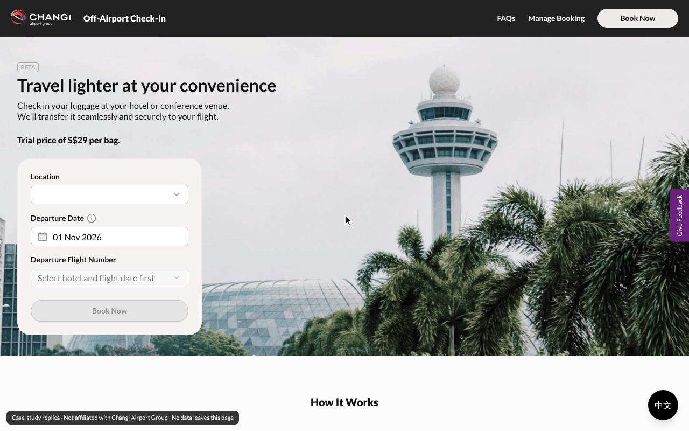

# Changi Off-Airport Check-In · Case-study replica



*Desktop walkthrough at 1280px: choose a hotel, date and flight → add luggage → enter personal details → review and
pay → FAQs → Manage Booking → 中文 and back. Recorded from this repo with `tools/record-demo.js`.*

Front-end replica of the Changi Off-Airport Check-In booking flow, contained Within is just the skeleton and backend for the front-end elements only. Built for developers to integrate their own backend. 

| | |
|---|---|
| Live demo (Vercel) | https://changiproject.vercel.app/ |
| Figma prototype | https://www.figma.com/proto/6KAACC2C1GxOySmUomqv7V/Untitled?page-id=16%3A40&node-id=19-1582&starting-point-node-id=19%3A1582&scaling=scale-down-width |
| Stack | Node server (`scripts/dev-server.js`, no dependencies) + static HTML + the site's own compiled Tailwind CSS + ES modules. |

## Run it

You need **Node.js 18 or newer** (check with `node -v`). Get it from https://nodejs.org if you don't have it.
There is nothing to install: the server uses only Node's built-in modules, so there is no `npm install`.

```bash
cd changi-oaci-replica     # the folder that contains package.json
npm start                  # then open http://localhost:3000
```

| Want to | Command |
|---|---|
| Use another port | `PORT=8080 npm start` (Windows PowerShell: `$env:PORT=8080; npm start`) |
| Open it from your phone on the same Wi-Fi | `HOST=0.0.0.0 npm start`, then visit `http://<your-computer-ip>:3000` |
| Restart automatically when `scripts/dev-server.js` changes | `npm run dev` |
| Stop | `Ctrl + C` |

If you see `Port 3000 is already in use`, pick another port as above.

**Jump straight to any step:** add `?preview=1`, e.g. `http://localhost:3000/booking-review/?preview=1`.
That loads the fictional sample booking in `data/booking.sample.json`. Without it, later steps send you
back to the landing page, like the live site.

**Edits show on refresh.** HTML, CSS, JS and JSON are served without caching, so change a file and reload.

`scripts/dev-server.js` serves only the site folders (pages, `_next`, `data`, `icons`, `images`, `flags`, `follow-us`, `replica`).
`docs/`, `tools/`, `.git` and `scripts/dev-server.js` itself return 404. To add a real backend, add routes to the `routes`
table at the top of `scripts/dev-server.js` (see [docs/INTEGRATION.md](docs/INTEGRATION.md)).

Opening `index.html` by double-click (`file://`) will not work: the pages use root-relative paths and load `/data/*.json` with `fetch`.
Any other static server (`npx serve .`, `python3 -m http.server 8080`) also works.

## Routes

| Route | Screen | Markup source |
|---|---|---|
| `/` | Landing + booking card | Saved page (zip) |
| `/booking-details/` | Step 1 · Trip Details | Saved page (zip) |
| `/booking-baggage/` | Step 2 · Luggage Details | Saved page (zip) |
| `/booking-contact/` | **Step 3 · Personal Details** (the brief's screen) | Live DOM capture* |
| `/booking-review/` | Step 4 · Review Booking | Saved page (zip) |
| `/manage-booking-pin/` | Manage Booking | Live DOM capture |
| `/faq/` | FAQs | Live DOM capture |

**Flow:** the landing card's Book Now goes straight to Step 2 (`/booking-baggage/`). Step 1 is reached from the header
Book Now and from the "Edit" links. The chain is set in `data/config.json` under `flow`.

**What is remembered:** the booking lives in `sessionStorage` for the tab. Going back to the landing page or Step 1 and
changing the hotel, date or flight keeps the luggage (Step 2) and personal details (Step 3) already entered; only the
schedule is replaced. The Terms tick on Step 4 is never stored and starts empty every time. "Leave Page" in the
leave dialog clears everything.

\* The zip's `booking-contact.html` was saved after moving on to Step 4, so it holds Step 4's markup.
Step 3 was captured from the live page instead. Details in [docs/PROVENANCE.md](docs/PROVENANCE.md).

## How it is built

The JavaScript follows **MVC**. Models own data and state, views own the DOM, controllers connect them
(one controller per page). There is no build step: plain ES modules.

```
index.html + style.css                  landing page and the styles only it uses
booking-details/  index.html + style.css   Step 1 (same pair in every page folder)
booking-baggage/  booking-contact/  booking-review/  faq/  manage-booking-pin/
components/                   shared by every page:
    header.html, footer.html, language-button.html   the markup, written once
    shared.css                                     their styles + buttons, fields, layout, text colours
    include.js                                     puts the .html files into each page's data-include slots
_next/static/chunks/*.css     the site's compiled Tailwind/global CSS, byte-identical (do not edit)
_next/static/media/           Lato (Google Fonts build) under the filenames the CSS expects
replica/css/mui-runtime.css   MUI styles captured from the live page (injected at runtime there)

replica/js/models/            M · data and state
    api.js                      DATA ADAPTER: the only file that knows where data comes from
    store.js                    booking state across steps (sessionStorage) + step guard
    flow.js                     which page follows which (reads "flow" in data/config.json)
    i18n.js                     language choice and text lookup
    leave.js                    "Leave this page?" skip flag and navigate()
    format.js                   display strings ("31 Oct 2026", "1 item(s)", "29.00") and the view model
replica/js/views/             V · everything that touches the DOM
    dom.js, templates.js        helpers and the HTML snippets (dropdowns, calendar, dialogs)
    button.js, dialog.js, accordion.js, chrome.js, footer.js (footer links), loading.js (dots overlay), summary.js, language.js (中文 / EN switch)
    fields.js, mui.js           hotel/date/flight pickers, MUI-style text, phone and checkbox fields
replica/js/controllers/       C · one script per page, loaded by that page's <script type="module">
    boot.js                     shared start-up (waits for components/include.js, then config, header, tooltips)
    landing, trip-details, luggage, personal-details, review, manage-booking, faq

scripts/dev-server.js, package.json       Node server (npm start), no dependencies
data/*.json                   all content: hotels, flights, prices, FAQ, countries, copy, flow
data/i18n/*.json              Chinese text for the 中文 button (zh.json, faq.zh.json)
tools/record-demo.js          records docs/demo.gif (needs Playwright + ffmpeg; see the comment at the top)
tools/archive/build_pages.py  one-off script that produced the first version of the pages (history only)
```

**Each page folder holds two files:** `index.html` (that page's markup only) and `style.css` (styles only that page
uses). Everything shared lives in `components/`: the header, footer and 中文 button are written once and each page
marks their place with `<div data-include="header"></div>`; `components/include.js` fills those slots before the page
scripts start, and the header slot keeps its 64/68px height so nothing jumps while it loads. Change the header once in
`components/header.html` and every page has it. CSS naming and rules: [docs/CSS.md](docs/CSS.md).

The HTML pages are now the **source of truth**. They are hand-formatted, with a header comment on every
page and section labels, so edit them directly.

The site's own JavaScript (Next.js/Turbopack bundles, Adobe Launch, Qualtrics, Google Translate)
is **not** included. It is wired to CAG's production booking, payment and analytics services.
`replica/js` re-implements only the UI behaviour.

## For developers connecting a backend

Read **[docs/INTEGRATION.md](docs/INTEGRATION.md)**. In short:

1. Replace the bodies of the functions in `replica/js/models/api.js` with calls to your endpoints. Keep the return shapes.
2. Everything a page shows is bound through `data-bind`, `data-field`, `data-action` and `data-list` attributes.
   No page code needs to change when data comes from an API.

## Licences

- Lato: SIL Open Font License (Google Fonts build via @fontsource/lato).
- Flags: `country-flag-icons` (MIT), see `flags/LICENSE`.
- Phone formatting: `libphonenumber-js` (MIT), see `replica/vendor/`.
- Changi / CAG names, logos, illustrations, copy and CSS belong to Changi Airport Group and are used
  here only for this private case study.
